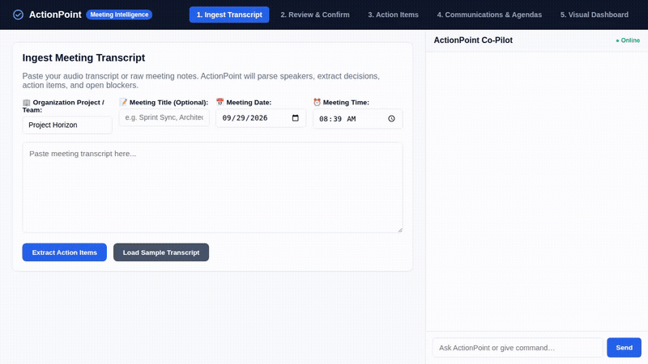

# ActionPoint — Meeting Intelligence & Action Tracker

ActionPoint is an agentic application powered by Gemini and the Google Agent Development Kit (ADK) that turns unstructured meeting transcripts into structured, trackable deliverables, multi-team communications, and live executive dashboards.



---

## 🚀 What the Agent Does

ActionPoint automates post-meeting administration across concurrent engineering and product teams:

1. **Structured Transcript Ingestion**:
   - Parses multi-speaker transcripts into structured summaries, key decisions, prioritized action items, and open technical questions.
   - Captures organizational metadata: Organization Team / Project (`Project Horizon`, `Project Atlas`), Meeting Title, Date (`YYYY-MM-DD`), and Meeting Time.
2. **Human-in-the-Loop Review**:
   - Displays extracted decisions and deliverable cards before database commitment, preventing hallucinated tasks or incorrect assignments.
3. **Multi-Team Task Registry**:
   - Persists all entities with scoped primary keys in SQLite (`meetings`, `decisions`, `action_items`, `open_questions`).
4. **Targeted Follow-Up Communications**:
   - **Individualized Deliverable Emails**: Generates personalized emails targeting specific attendees, highlighting only their assigned deliverables, deadlines, and priority.
   - **Team Recap Emails**: Formats clean Markdown digests with executive summaries, confirmed decisions, and action item tables.
   - **Structured Agendas**: Builds time-boxed follow-up agendas featuring Markdown tables for unresolved technical blockers and lead investigators.
5. **Visual Executive Dashboard**:
   - Real-time priority distribution progress bars (`Critical`, `High`, `Medium`, `Low`).
   - Executive hero card summarizing the latest meeting and active attendees.
6. **Conversational AI Co-Pilot**:
   - Embedded sidebar agent that responds to natural language queries by executing database lookups and tool calls.

---

## 🛠️ Implemented Architecture & Tools

Based on the actual code in `simple-agent/app/` and `agents-cli-manifest.yaml`:

### Wired Tools (`simple-agent/app/tools.py`)
* `extract_meeting_action_items`: Structured Gemini 2.5 Flash extraction with strict JSON schema enforcing title, summary, attendees, decisions, action items, and open questions.
* `confirm_and_save_meeting`: Commits validated meeting records, decisions, action items, and questions to the database.
* `query_action_items`: Queries tasks filtered by project, owner, status, or overdue criteria.
* `update_action_item_status`: Updates task status (`pending`, `in_progress`, `done`, `blocked`).
* `generate_follow_up_agenda`: Formats time-boxed meeting agendas with structured Markdown tables for blockers.
* `draft_follow_up_email`: Formats project-level team recap emails.
* `draft_individual_emails`: Personalizes attendee-specific email messages scoped to their project team.
* `generate_meeting_visual_summary`: Generates 16:9 infographic summary card images using Vertex AI Imagen 3.

### Google Cloud & Agent Services Wired Up
* **Google Gemini 2.5 Flash** (`gemini-2.5-flash`): Primary LLM for agent reasoning, tool calling, and transcript extraction.
* **Vertex AI Imagen 3** (`imagen-3.0-generate-002`): Image generation for meeting visual summary cards via the `google-genai` SDK.
* **Google Agent Development Kit (ADK)**: Core agent framework (`google.adk.agents.Agent`, `google.adk.apps.App`).
* **Agent Runtime (A2A)**: Configured in `agents-cli-manifest.yaml` (`deployment_target: "agent_runtime"`, `is_a2a: true`).

### Database & Storage Layer
* **SQLite Database**: Local relational registry for meetings, decisions, action items, open questions, projects, and people (`actionpoint.db`).
* **Local File Storage**: File storage for raw transcripts (`transcripts/`) and generated visual summary cards (`summary_cards/`).

---

## 📋 Feature Implementation Status

| Feature / Service | Status | Notes |
| :--- | :--- | :--- |
| **Gemini 2.5 Structured Extraction** | ✅ Implemented | Uses `gemini-2.5-flash` with structured JSON schema |
| **Review & Confirm Screen** | ✅ Implemented | Human-in-the-loop review cards before registry save |
| **Action Items Table** | ✅ Implemented | Filterable action item registry |
| **Multi-Team Communications** | ✅ Implemented | Project filtering & individualized attendee emails |
| **Visual Dashboard** | ✅ Implemented | Dynamic priority progress bars & executive hero card |
| **Interactive AI Co-Pilot** | ✅ Implemented | Embedded chat panel running ADK tool calls |
| **Vertex AI Imagen 3** | ✅ Implemented | Wired in `generate_meeting_visual_summary` |
| **Google Cloud Storage (GCS)** | ⏳ *Planned, not yet implemented* | Currently using local disk storage (`transcripts/`) |
| **Cloud Firestore** | ⏳ *Planned, not yet implemented* | Currently using SQLite database (`actionpoint.db`) |
| **Vertex AI Memory Bank** | ⏳ *Planned, not yet implemented* | ADK session configured as `session_type: "none"` |
| **A2UI Custom Renderer** | ⏳ *Planned, not yet implemented* | Frontend renders via responsive HTML5/CSS3 + DOM |

---

## 💻 Setup & Local Run Instructions

### Prerequisites
* Python 3.10+
* Google Cloud project with Vertex AI API enabled
* `gcloud` authenticated (`gcloud auth application-default login`)

### 1. Clone & Set Up Virtual Environment
```bash
git clone <your-repo-url>
cd <repo-folder>

python3 -m venv .venv
source .venv/bin/activate
pip install -r simple-agent/requirements.txt
pip install fastapi uvicorn requests
```

### 2. Configure Environment Variables
```bash
export GOOGLE_CLOUD_PROJECT="your-gcp-project-id"
export GOOGLE_GENAI_USE_VERTEXAI="true"
export ACTIONPOINT_DB_PATH="simple-agent/actionpoint.db"
```

### 3. Initialize the Database
```bash
python3 -c "from app.storage import init_db; init_db()"
```

### 4. Start the Application
Run the local gateway proxy:
```bash
cd frontend
python3 local_proxy.py
```

Open a web browser and navigate to the local server port printed in the terminal (default: port `8088`).
